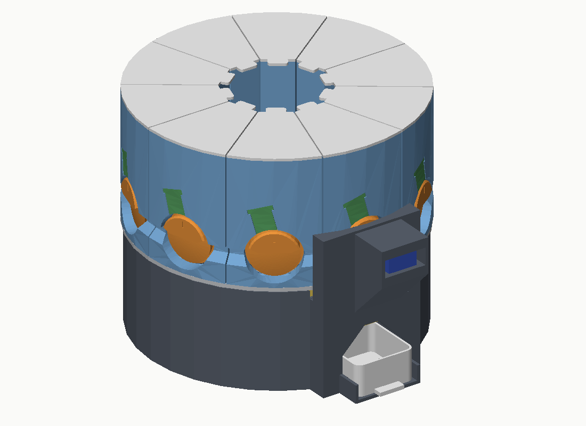
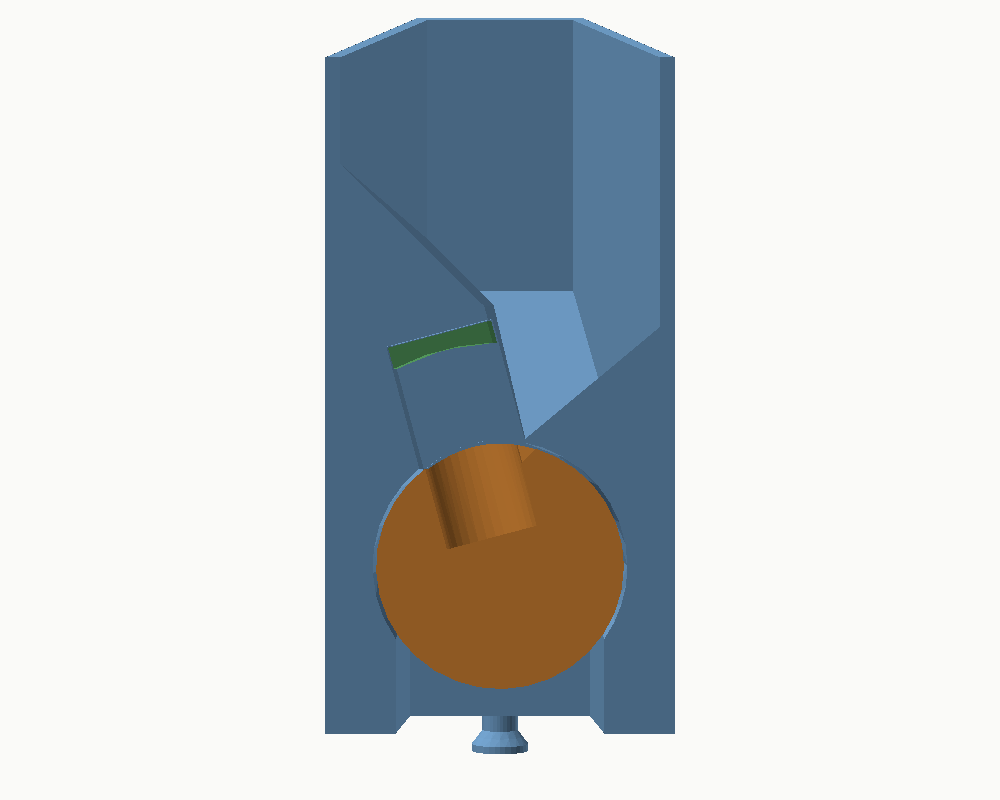

# Modular carousel pill dispenser

A 3D-printable, Wi-Fi connected dispenser for pills and supplements. Ten passive modules
(about 100 ml each) ride on a carousel; one drive unit in the base serves all of them, so adding a
module means printing plastic only. An app talks to it over a small REST API. The electronics plug
together: nothing is soldered.

**Status: design revision 0.2, not yet built.** The geometry was checked in CAD (collisions, fits,
pill path) and the firmware logic was exercised in a host simulation, but nothing has been printed
or run on real hardware. Expect a tuning round. See [What was checked](#what-was-checked).



## How it works

| | |
|---|---|
| **Modules** | Wedge-shaped hoppers with a horizontal metering roller at the bottom. The roller has one pocket that fits exactly one pill. No motor, no electronics, no screws. |
| **Roller + gate** | The only pill-specific parts, always used as a pair. Five presets are included; `cad/make_roller.py` generates a pair for any pill up to 30 x 12.5 x 12.8 mm. |
| **Carousel** | A plate on two 608 bearings, turned by a 28BYJ-48 stepper (4:1 gear). It brings the wanted module to the station at the front. A flag under the hub passes through a light barrier once per turn: that is the home position. |
| **Station** | One MG90S servo with a two-prong drive dog. Each roller has a flat "tooth" at its outer end; when a module arrives, the tooth slides over the prongs. The servo turns the roller about 145 degrees and back. |
| **Chute** | A V-shaped slide under the station. A second light barrier 1.6 mm above the bottom of the V sees every pill, so the firmware knows whether a pill really came out, retries if not, and reports an empty or jammed module. |
| **Cup** | Sits under the station, pulls out to the front. |

Size: 212 mm diameter, 250 mm deep including the station, 179 mm high.

### How one pill is separated



Seen along the roller: a roof beam covers the roller. Pills run down the flank on the open side and
roll sideways under the roof. The gap under the roof ends at a wall, and the pocket is parked
directly in front of that wall. Three details do the work:

- **The roller is a cone** (8 degrees, small end towards the centre of the carousel), and the pocket
  sits at the small end. A pill that lies on the roller next to the pocket is on a slope. It stays
  there while nothing moves, but every time the roller turns under it, it slides, and a sliding
  pill drifts downhill, towards the pocket.
- **The gate keeps pills flat.** Each roller comes with a gate that hangs under the roof and leaves
  a gap only a little higher than one pill (1.4 to 2 mm more). Pills arrive one layer deep, and a
  long pill cannot stand on end in the pocket: pocket depth plus gap is shorter than the pill
  (27.7 mm of room for a 30 mm softgel, 17.9 mm for a 21.7 mm capsule).
- **The pocket's rear edge is sloped.** A pill that hangs into the pocket only partly is lifted
  back out by that slope when the roller turns, instead of being pinched against the wall. Before
  every stroke the roller also makes a short turn forward and back; that pushes waiting pills
  square against the wall, where the next one drops into the pocket.

## Parts to buy

A list with shop links and the prices found is in [`docs/shopping-list.md`](docs/shopping-list.md).

Electronics. Everything plugs into a small breadboard, no soldering:

| Qty | Part | Notes |
|---|---|---|
| 1 | Seeed Studio XIAO ESP32-C6 with pre-soldered headers | sold as its own version, SKU 102010636. XIAO ESP32-S3 works with the same pin names. Not the C3 (boot pins). |
| 1 | 28BYJ-48 stepper, 5 V, with ULN2003 driver board | the usual kit; the motor plugs into the board |
| 1 | MG90S micro servo, 180 degree version | SG90 fits too, MG90S has metal gears |
| 2 | IR break-beam sensor pair with 3 mm LEDs, wires with header ends | Adafruit 2167 or the same part elsewhere: two black housings 20 x 10 x 8 mm per pair. One pair is the home sensor, one counts pills. |
| 1 | Mini breadboard (170 points) | |
| 1 set | Jumper wires, male-male and male-female | about 10 of each |
| 1 | USB-C cable and 5 V / 2 A supply | powers everything |
| opt. | Push button, active buzzer (3.3 V), servo extension lead 15 cm | |

No resistors and no capacitor: the receivers of the light barriers work with the pull-ups inside
the ESP32.

Hardware:

| Qty | Part |
|---|---|
| 1 | Hex bolt M8 x 80, 1 washer M8, 1 self-locking nut M8 |
| 2 | Ball bearing 608 (8 x 22 x 7) |
| 2 | Screw M3 x 10 (stepper) |
| 4 | Screw M3 x 12 (tower) |
| 10 | 60 mm pieces of 1.75 mm filament (roller keeper pins) |
| 4 | Stick-on rubber feet (optional) |

## Parts to print

All parts are exported in print orientation and need **no supports**. PETG is recommended
(stiffer studs, less wear on the rollers); PLA works. 0.4 mm nozzle, 0.2 mm layers, 3 walls,
15 % infill. Largest part: 212 mm, so a 220 mm bed is enough (designed with a 256 mm bed in mind).

| File (`stl/`) | Qty | Filament | Notes |
|---|---|---|---|
| `base_tub` | 1 | ~240 g | |
| `carousel` | 1 | ~110 g | printed upside down, slot numbers end up on top |
| `tower` | 1 | ~60 g | upright |
| `chute` | 1 | ~20 g | on its side, so the sensor pockets are vertical |
| `cup`, `pinion`, `drive_dog`, `hub_cap` | 1 each | ~20 g | print pinion and drive dog slowly |
| `module_body` | 1 per module | ~80 g | upside down (rim on the bed), brim recommended |
| `module_lid` | 1 per module | ~10 g | |
| `roller_*` | 1 per module | ~17 g | standing on its small end, pocket walls come out smooth |
| `gate_*` | 1 per module | ~5 g | flat; same name as the roller it belongs to |

A full set with 10 modules is about 1.6 kg of filament. Base, carousel and station alone: about 0.45 kg.

### Which roller and gate

| Files | For | Pocket | Gap under the gate |
|---|---|---|---|
| `roller_S_tab6` + `gate_S_tab6` | small round tablets about 6 x 3 mm | 7.2 mm round, 3.5 deep | 4.4 mm |
| `roller_M_tab10` + `gate_M_tab10` | round tablets about 10 x 5 mm | 11.2 mm round, 5.5 deep | 6.4 mm |
| `roller_L_cap0` + `gate_L_cap0` | capsules size 0, oblong tablets about 21 x 7.5 mm | 23.5 x 8.5, 8.4 deep | 9.5 mm |
| `roller_L_cap00` + `gate_L_cap00` | capsules size 00 | 25.3 x 9.4, 9.3 deep | 10.4 mm |
| `roller_XL_soft` + `gate_XL_soft` | large softgels up to 30 x 12.5 mm | 31.8 x 13.3, 13.2 deep | 14.5 mm |

A pocket only meters reliably when it fits: the pill must lie fully below the roller surface, and a
second pill must not fit beside or on top of it. For anything else, measure the pill and run

```
cd cad
python3 make_roller.py --shape oblong --L 19 --W 8 --T 6.5 --name magnesium
python3 make_roller.py --shape round  --L 8 --T 3.5 --name vitd
```

(needs `pip install cadquery trimesh`). It writes the roller and the matching gate. Limits of the
standard module: 30 mm long, 12.5 mm wide, 12.8 mm thick. Very small pills (under about 5 mm) and
half tablets are outside what this design was laid out for. Short, thick oblong pills (shorter than
about twice their thickness plus 4 mm) can still tip up on end under the gate; the script says so
when that applies.

## Wiring

Everything runs from the 5 V of the USB-C cable plugged into the XIAO. The XIAO sits across the
middle of the breadboard. Use four of the free rows as rails: one for 5 V, one for 3.3 V, two for
GND (joined by a jumper), each fed by a jumper from the XIAO pin of that name.

| XIAO pin | Goes to |
|---|---|
| 5V | ULN2003 board `+`, servo red |
| GND | ULN2003 board `-`, servo brown, the black wire of all four light-barrier halves |
| 3V3 | red wire of both receivers (the halves with three wires), red wire of the home emitter |
| D0 | signal wire (white) of the receiver in the chute |
| D1 | signal wire (white) of the receiver under the carousel |
| D4 | red wire of the emitter in the chute |
| D2 | optional button to GND |
| D3 | servo orange (signal) |
| D6 | optional buzzer `+` |
| D7, D8, D9, D10 | ULN2003 IN1, IN2, IN3, IN4 |

The emitter in the chute is fed from D4 on purpose. Before every stroke the firmware switches it
off and on and checks that the receiver follows. A loose plug, two halves that do not face each
other, or a pill lying in the chute are noticed before a pill is released, not after. The same test
tells the firmware which level means "blocked", so it does not matter which way round a particular
light barrier switches. An emitter draws about 10 mA at 3.3 V, which a pin can supply.

If the ESP32 resets when the servo starts, the supply or the cable is too weak. A 470 uF capacitor
pushed into the 5 V and GND rails (long leg to 5 V) cures that; so does a shorter USB cable.

## Assembly

1. **Carousel.** Press one 608 bearing into each end of the hub.
2. **Base.** Push the M8 bolt up through the floor (the head sits in the hex pocket). Drop the
   stepper between its two posts, shaft towards the centre, fix with 2 x M3 x 10. Press the pinion
   onto the shaft until it stops.
3. **Sensors.** Push the two halves of one light barrier into the two cradles next to the centre
   pillar, lens facing lens. Push the halves of the other one into the pockets in the two sides of
   the chute, lens first, then drop the chute into its seat behind the cup bay. If a half sits
   loose, a strip of tape around it is enough.
4. **Electronics.** Stick the breadboard onto the marked rectangle with the XIAO's USB-C socket
   facing the opening in the wall. Wire as in the table.
5. **Tower.** Slide the servo into the tower from the front (output shaft towards the carousel, on
   the centre line), fix with its two screws, lead the cable through the narrow slot to the left of the
   servo nose into the tub. Fix the tower with 4 x M3 x 12 from inside the tub. The holes in the tub are slots:
   leave the screws slightly loose for now.
6. **Carousel on.** Lower it onto the bolt, add washer and self-locking nut. Tighten until the
   plate has no wobble but still spins freely. Push the hub cap onto the nut.
7. **Firmware**, then calibration (below). Press the drive dog onto the servo only after the servo
   has moved to its park position.
8. **Modules.** Lay the gate onto its roller (the tab drops into the groove near the tooth), push
   both into the module together, and slide a piece of filament through the small hole under the
   roller to keep them in. Set the module's three studs into the wide ends of the keyholes, slide
   it towards the centre until the bump clicks into its hole. Fill, close.

To remove a module: turn it away from the station (`POST /present`), lift the outer edge slightly
and pull outwards.

## Firmware

Folder `firmware/`. Open `firmware/pilldispenser/pilldispenser.ino` in the Arduino IDE
(board package "esp32" 3.x, board "XIAO_ESP32C6", library "ArduinoJson" 7.x), or run
`pio run -t upload` in `firmware/` with PlatformIO.

First start: the dispenser opens the Wi-Fi network `PillDispenser-xxxx`. Join it, open
`http://192.168.4.1/setup`, enter your Wi-Fi. After the restart it answers at
`http://pilldispenser.local/` with a small test page. Set an API key before you rely on it:

```
curl -X PUT http://pilldispenser.local/api/v1/settings -H 'Content-Type: application/json' \
     -d '{"api_key":"a-long-random-string"}'
```

Send request bodies as JSON with `Content-Type: application/json`.

### Calibration (once)

Use the test page or `curl`. The examples assume
`H=http://pilldispenser.local/api/v1` and `J='Content-Type: application/json'`.

1. **Sensors.** `curl $H/diag` must show `"beam_ok": true`. If not, the two halves in the chute do
   not see each other or a plug is wrong. Turn the carousel by hand: `home_level` changes while the
   flag is between the two halves under the hub, and only there.
2. **Servo.** `curl -X POST $H/servo -H "$J" -d '{"position":"park"}'`, then press the drive dog onto the
   spline with the prongs horizontal and fix it with the servo's horn screw. Fine-tune with
   `servo_park_us`. `{"position":"end"}` should turn the dog about 150 degrees, the upper side of the roller moving
   to the left when you look at the tower from the front; adjust `servo_end_us` (if the servo runs
   the wrong way, swap the two values' roles: park near 2280, end near 610).
3. **Direction.** `curl -X POST $H/goto -H "$J" -d '{"slot":2}'`. If slot 10 arrives instead of slot 2:
   `curl -X PUT $H/settings -H "$J" -d '{"car_dir":-1}'`, then `POST $H/home`.
4. **Slot 1.** `POST $H/home`, then nudge with `curl -X POST $H/jog -H "$J" -d '{"steps":40}'` (negative
   values go back) until module 1 stands exactly in front of the tower with its roller centred on
   the drive dog. `curl -X POST $H/calibrate/slot1` stores it.
5. **Tower height.** With a module at the station, the prongs should sit 0.5-1 mm below the flat
   of the roller tooth and must not touch the module. Shift the tower in its slots, tighten.
6. **Try it.** `curl -X POST $H/dispense -H "$J" -d '{"items":[{"slot":1,"count":1}]}'`

## API

Full description: [`docs/openapi.yaml`](docs/openapi.yaml). The essentials:

| Call | Does |
|---|---|
| `GET /api/v1/status` | state, slot at the station, error, Wi-Fi |
| `GET /api/v1/slots`, `PUT /api/v1/slots/3` | names, stock (`count`), low-stock threshold |
| `POST /api/v1/dispense` | `{"request_id":"...","items":[{"slot":1,"count":2}]}` - returns a job at once |
| `GET /api/v1/jobs/17` | progress: per item `dispensed` and `missed` |
| `GET /api/v1/events?since=42` | everything that happened: job_done, slot_empty, low_stock, double, ... |
| `GET/POST/PUT/DELETE /api/v1/schedules` | dose times stored on the device, `auto` or `confirm` mode |
| `POST /api/v1/present` | `{"slot":4}` turns a module to the refill position |
| `POST /api/v1/stop`, `POST /api/v1/home` | stop everything; re-home |
| `GET/PUT /api/v1/settings` | time zone, API key, webhook, motion tuning |
| `GET /api/v1/diag` | sensor self-test and raw levels, for setup |

Connecting an app:

- **Discovery:** mDNS service `_pilldispenser._tcp`, or the fixed name `pilldispenser.local`.
- **Auth:** header `Authorization: Bearer <api_key>`.
- **Dose now:** `POST /dispense` with a unique `request_id`. Repeating the same id never dispenses
  twice, so the app can retry safely on a flaky connection.
- **Dose plan on the device:** push `/schedules`; the dispenser keeps time by NTP and works without
  the app. In `confirm` mode it only announces the dose (`dose_due`) and waits for the button or
  `POST /schedules/{id}/run`.
- **What really happened:** poll `/events?since=<last seq>` or set `webhook_url`; the device then
  POSTs each relevant event as JSON to the app's backend. `dispensed` is what the light barrier
  counted, not what was requested.

## Adding modules, changing the layout

The base has 10 places. Six modules leave four spare; an empty place needs nothing. Every number in
`cad/dispenser.py` is a parameter (`N_SLOTS`, radii, heights); `python3 export.py` regenerates all
STL and STEP files and `python3 checks.py` re-runs the collision checks. Ten places is what fits on
a 212 mm carousel with pills up to 30 mm long; more places need a larger diameter or a shorter
roller. A second dispenser on the same network is the simpler way to go beyond 10: give it another
`hostname`.

## What was checked

Done in CAD (`cad/checks.py`, `cad/func.py`):

- no part touches another while the carousel turns a full revolution, including modules, rollers,
  gates and the home flag passing the tower, chute, light barriers and motor;
- no contact during the servo stroke; the drive dog takes the roller along after 4.8 degrees of
  play in both directions;
- roller and gate cannot be pulled out past the keeper pin, the gate cannot leave without the
  roller, and the roller turns freely;
- modules slide in and lock without interference; hopper volume 102 ml usable (112 ml to the rim);
- a 30 x 12.5 mm softgel, a size 0 capsule and a 6 x 3 mm tablet stay enclosed while the roller
  turns and have a free path into the chute at the end of the stroke;
- a second pill waiting on top of the full pocket fits under the gate, and 2.5 mm higher it does
  not: the gate limits the layer to one pill;
- for all five presets the pocket is closed towards the hopper before it opens to the outlet;
- the home flag blocks its light barrier at the home position and nowhere else;
- all 20 STL files are closed meshes.

Done in a host simulation of the firmware (no ESP32 involved): homing with either output polarity
of the light barrier and from different starting positions, slot positioning and shortest path,
recovery after lost steps, job handling with an empty module, repeated request id, two pills in one
stroke, unplugged receiver, unplugged emitter.

Not done, and where I expect tuning:

- **No print, no hardware test.** Fits are nominal (0.2-0.5 mm clearance). The servo spline bore
  (4.7 mm), the bearing seats (22.2 mm) and the fit of the gate in its window are the ones most
  likely to need a tweak.
- **The firmware was not compiled for the ESP32** in this environment (no toolchain). It passes a
  syntax check with stand-in headers; a typo against the real Arduino or ArduinoJson API is
  possible.
- **How real pills behave is reasoned, not measured.** That a pill drifts down the cone, that the
  sloped pocket edge lifts a half-seated pill, and that pills feed reliably through the gap under
  the gate follow from the geometry and from friction estimates. Sticky softgels, chipped tablets
  or pills much smaller than their pocket can still jam or bridge. The firmware then retries and
  finally reports the slot as empty or jammed. It never dispenses blind unless `beam_required` is
  switched off.
- **Light barrier housings:** the mounts assume 20 x 10 x 8 mm with the lens in the middle of a
  small end face. Check one against the cradle before printing the base.
- Translucent softgels may not break an infrared beam completely. Not tested.
- Dimensions of MG90S clones vary by a few tenths; the tower height is adjustable for that reason.

## Safety

This is a hobby device, not a medical product. It can miscount. For medication where a missed or
doubled dose matters, check the cup. Keep it away from children, and keep light- or
moisture-sensitive medication in its original packaging.

## Repository layout

```
cad/        dispenser.py (all parameters and parts), export.py, checks.py, func.py, make_roller.py (roller + gate)
stl/        printable parts, in print orientation
step/       the same as STEP, plus assembly.step
firmware/   Arduino / PlatformIO project; test_host/run.sh = syntax check and motion simulation on a PC
docs/       openapi.yaml, shopping-list.md, parts.json, images, preview/index.html (interactive 3D preview, needs internet)
```
